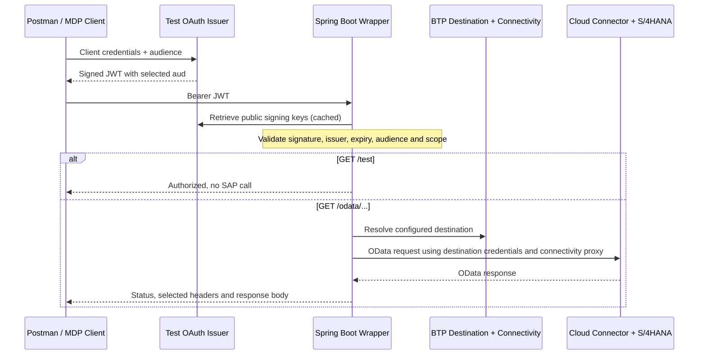

# MDP BTP Wrapper

An internal proof of concept for testing **OAuth 2.0 Client Credentials with an
explicit audience** in an MDP client, while keeping SAP backend authentication
independent from client authentication.

This repository contains **two separate Spring Boot / Java 21 applications**:

| Application | Purpose | Default local port |
| --- | --- | --- |
| Wrapper, at the repository root | Validates incoming JWTs and proxies read-only OData requests through an SAP BTP destination | `8080` |
| [Test issuer](test-issuer/README.md) | Authenticates a test client and issues five-minute RS256 tokens for a requested audience | `9000` |

You can test the audience feature locally without SAP or BTP. Calling the real
SAP API additionally requires BTP runtime capacity, service bindings, a destination
and Cloud Connector connectivity. This is **not a production authorization service**.

## How it works



The audience is an identifier, **not another URL to call**. Use
`urn:mdp:btp-wrapper` for successful requests. The issuer also permits
`urn:mdp:other-api` so a client can obtain a validly signed token that the wrapper
must reject. Unknown audiences are rejected by the issuer itself.

The backend request follows this path:

```text
Postman / MDP client (Bearer JWT)
  -> Spring Boot wrapper
  -> BTP Destination: S4_S4H_100_KNX_ODATA
  -> BTP Connectivity -> Cloud Connector -> S/4HANA
```

Cloud Connector administration is at https://localhost:8444/. That address is
not an application backend or a BTP destination URL. Cloud Connector must remain
running and connected to the same BTP subaccount used by the application.

## Project status

- Both applications have been built and tested locally: **19 wrapper tests and
  13 issuer tests** passed. No SAP credentials are needed for these tests.
- BTP Destination, Connectivity and XSUAA instances were prepared. Deployment
  was then **paused** because the target organization's runtime quota is zero
  for memory, routes and application instances.
- The attempted deployment left `mdp-test-issuer` **stopped, without a route**.
  The wrapper has not been deployed. No client secret was configured in BTP.
- Live BTP-to-SAP access is unverified. A remaining Spring MVC advisory requires
  review before deployment; see [validation evidence](runtime-validation-report.md).

## Code guide

| Location | Responsibility |
| --- | --- |
| [WrapperApplication.java](src/main/java/com/example/mdp/WrapperApplication.java) | Starts the wrapper |
| [SecurityConfiguration.java](src/main/java/com/example/mdp/SecurityConfiguration.java) | Enforces Bearer authentication, read scope and read-only access |
| [ODataController.java](src/main/java/com/example/mdp/ODataController.java) | Exposes health, authentication-test and OData endpoints |
| [ODataGateway.java](src/main/java/com/example/mdp/ODataGateway.java) | Resolves the destination and forwards bounded HTTP requests through SAP Cloud SDK |
| [application.yaml](src/main/resources/application.yaml) | Wrapper environment configuration, including trusted issuer and audience |
| [IssuerConfiguration.java](test-issuer/src/main/java/com/example/mdp/issuer/IssuerConfiguration.java) | Registers the test client, validates requested audiences and configures signing keys |
| [Wrapper tests](src/test/java/com/example/mdp/WrapperIntegrationTest.java) | Signed-token validation and proxy behavior against a local SAP fixture |
| [Issuer tests](test-issuer/src/test/java/com/example/mdp/issuer/IssuerIntegrationTest.java) | Real HTTP token requests, OAuth errors and public-key verification |
| [manifest.yml](manifest.yml) / [issuer manifest](test-issuer/manifest.yml) | Separate Cloud Foundry deployments |

There is no UI or database. The two Maven projects are independent; the root build
does not build the issuer. The main libraries are Spring Boot, Spring Security,
Spring Authorization Server and SAP Cloud SDK for Java.

## Endpoints

| Endpoint | Access | Purpose |
| --- | --- | --- |
| `GET /health` | Public | Application liveness only; does not check SAP |
| `GET /test` | JWT + `odata.read` scope | Test authentication without calling SAP |
| `GET /odata/` | JWT + `odata.read` scope | OData service document |
| `GET /odata/$metadata` | JWT + `odata.read` scope | Service metadata |
| `GET /odata/<EntitySet>?$top=1&$format=json` | JWT + `odata.read` scope | Entity reads |
| `HEAD /odata/**` | JWT + `odata.read` scope | Backend response headers |

Writes and `$batch` POST requests are intentionally disabled. This is a bounded
read-only proxy, not a full OData facade: absolute links in SAP response bodies
(including pagination links) are not rewritten. To follow a backend next link,
use its service-relative path and query through `/odata/`, not the internal host.
Responses are limited to 10 MiB; use OData paging for larger results.

## Authentication boundaries

The wrapper validates RS256 signatures against a configured JWKS endpoint,
issuer, token timestamps and the expected audience. The token must also carry
`odata.read` in its `scope` or `scp` claim. Invalid tokens receive 401; valid
tokens without the scope receive 403. No client JWT or cookie is forwarded to SAP.
Backend authentication is supplied exclusively by the BTP destination and SDK.

The wrapper is a resource server. A separate **test-only OAuth issuer** is now
available under [test-issuer](test-issuer/README.md), using Spring Authorization
Server with an explicit `audience` request parameter. Its setup guide covers
local Postman testing and deployment. Build and run it separately from the wrapper.
The XSUAA binding below serves SDK platform connectivity; it does not automatically
configure the incoming JWT issuer or implement the audience request parameter.

## Configuration

| Environment variable | Value |
| --- | --- |
| `JWT_ISSUER_URI` | Required, exact trusted issuer from the token's `iss` claim |
| `JWT_JWK_SET_URI` | Required, trusted issuer's public JWKS URL |
| `JWT_AUDIENCE` | Defaults to `urn:mdp:btp-wrapper` |
| `DESTINATION_NAME` | Defaults to `S4_S4H_100_KNX_ODATA` |
| `S4_SERVICE_PATH` | Defaults to `/sap/opu/odata/sap/ZUI_KX_ODATA_OP_V2` |
| `PORT` | Defaults to `8080`; BTP supplies it on deployment |

Use HTTPS for the issuer and JWKS URLs in BTP. Never configure either URL from
untrusted request data. Credentials, tokens and service bindings must not be committed.

## Destination and Cloud Connector

Verify the existing destination in the BTP cockpit:

- Name: `S4_S4H_100_KNX_ODATA`, type: HTTP, proxy type: OnPremise.
- URL: the Cloud Connector **virtual host and port**, not `localhost:8444`.
  An origin-only URL uses `S4_SERVICE_PATH`. If the destination URL has a path,
  that path must be the complete OData service root; it is used unchanged.
  Do not put query parameters, credentials or fragments in the URL.
- Set `sap-client=100` as a destination property if required by your backend.
- Set `CloudConnectorLocationId` if the connector uses a nonempty Location ID.
- Expose `/sap/opu/odata/sap/ZUI_KX_ODATA_OP_V2` and its subpaths in Cloud Connector.
- Keep backend credentials in the destination. Principal propagation is not
  supported by this technical-client flow; the incoming JWT is not an SAP user token.

If you instead configure OAuth2ClientCredentials on the destination, verify SAP
token-endpoint reachability separately from the OData mapping. A green Cloud
Connector connection alone does not prove successful authentication or OData
access. No backend authentication settings are changed by this project.

The destination must be visible to the bound Destination service: use a
subaccount-level destination, or bind the existing service instance that owns
an instance-level destination instead of creating a new one.

The original test destination uses BasicAuthentication, OnPremise and an empty
Location ID, with the complete OData service path in its URL. This backend flow
does not use the SAP token endpoint. Prefer an HTTPS connector-to-SAP mapping for
sensitive data; the tunnel does not encrypt a final HTTP hop.

## Build and local verification

Use Maven 3.9+ and JDK 21+. Check `mvn -version`, since it can use a different
JDK than `java -version`. Tests were run on JDK 25 with Java 21 as the compilation
target. Java 8 cannot run either application.

```powershell
mvn.cmd clean verify
mvn.cmd -f test-issuer/pom.xml clean verify
```

On Linux/macOS, use `mvn` instead of `mvn.cmd`.

The tests start the actual Spring HTTP server, generate RSA-signed JWTs, publish
local public keys, and use the SAP SDK against a local mock backend. They need
no SAP credentials and make no changes to SAP. The test processes stop afterward.

For manual testing, follow the [issuer local setup and Postman guide](test-issuer/README.md#local-setup).
It starts the issuer on port 9000 using a secret entered directly into your
terminal. In a second terminal, start the wrapper against it:

```powershell
$env:JWT_ISSUER_URI = 'http://localhost:9000'
$env:JWT_JWK_SET_URI = 'http://localhost:9000/.well-known/jwks.json'
$env:PORT = '8080'
mvn.cmd spring-boot:run
```

Request a token with Basic client authentication from `POST http://localhost:9000/oauth/token`,
using this form body:

```text
grant_type=client_credentials&audience=urn:mdp:btp-wrapper&scope=odata.read
```

Call `GET http://localhost:8080/test` with the returned Bearer token: expect 200.
Request a second token with audience `urn:mdp:other-api`: the same wrapper call
must return 401. This is the central feature this project demonstrates.

The local API is then http://localhost:8080/health. `/test` can validate real
tokens without SAP connectivity. Calling a BTP OnPremise destination locally
requires an explicitly configured BTP connectivity/proxy access setup; service
credentials alone do not reproduce the Cloud Foundry network. Deploy to BTP for
the initial real SAP connectivity check. Never disable TLS validation to bypass
certificate problems.

## Deploy to BTP Cloud Foundry

Prerequisites: a logged-in Cloud Foundry CLI, the intended org/space, entitlements
for Destination, Connectivity and XSUAA, application runtime capacity, and the
Java 21-capable `sap_java_buildpack_jakarta` buildpack used by the manifests.
The two apps request 1,792 MB combined and require two routes and two running
instances; provide additional deployment headroom as appropriate.

The wrapper manifest references `dest-a3k`, `mdp-wrapper-connectivity` and
`mdp-wrapper-xsuaa`. Those instances exist in the original test space. For another
environment, create or reuse suitable instances and update the binding names;
do not assume they already exist. Verify your target and quota before deploying:

```powershell
cf target
cf services
cf org <your-org-name>
cf org-quota <quota-name-shown-by-cf-org>
```

Deployment is currently paused at the quota prerequisite. Once capacity is
available, deploy the test issuer using its [deployment guide](test-issuer/README.md#btp-deployment)
first, then use its HTTPS origin and JWKS endpoint below. Do not overwrite shared
service settings or place client secrets in either manifest.

```powershell
mvn.cmd clean verify
cf push --var 'jwt-issuer-uri=https://<trusted-issuer>' --var 'jwt-jwk-set-uri=https://<trusted-issuer>/<jwks-path>'
cf app mdp-btp-wrapper
```

Use the HTTPS route returned by `cf app` in Postman. Obtain a token from the
configured issuer with audience `urn:mdp:btp-wrapper` and scope `odata.read`,
then set Authorization to Bearer Token. First call `/test`, then
`/odata/$metadata`, then a known entity set with `$top=1`. The original SAP token
is not an incoming wrapper token unless explicitly issued under this trust contract.

## Validation scope

`mvn test` covers startup, public liveness, valid and invalid signed tokens,
issuer/audience/expiry/signature rejection, scope enforcement, disabled writes,
service-root confinement, raw OData query preservation, metadata forwarding,
HEAD, backend 404, no redirect following and cookie/authorization isolation.

Live BTP service bindings, destination token acquisition, Cloud Connector routing,
Java 21 runtime execution and actual SAP responses still require verification.
There is no UI, database, or persistent test data. Docker was unavailable during
validation; local HTTP fixtures were used for the external HTTP boundaries.

Latest local result: `mvn.cmd -B -q verify` passed all 19 tests and packaged the
application. See `runtime-validation-report.md` for evidence and limitations.

## Remaining security finding

The dependency advisory scan reported `CVE-2026-47884` against Spring MVC 6.2.19
(XsltView path handling). This application uses REST controllers and does not
configure XsltView, but this is not a formal exploitability assessment or waiver.
The scanner recommends Spring Framework 7.0.9+, requiring a coordinated major
framework upgrade. Eight other reported advisories were cleared by compatible
dependency updates. Treat deployment as pending security review; this project
is not being represented as vulnerability-free or production-ready.